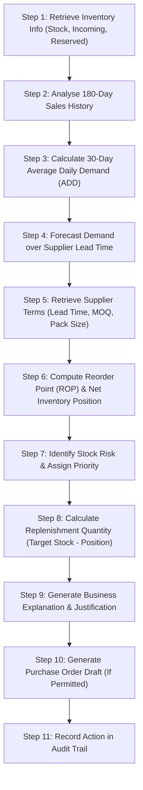

# RetailIQ Autonomous Inventory Agent – Architecture & Workflow

## Overview
The **RetailIQ Autonomous Inventory Agent** is an enterprise AI decision agent designed to predict product demand, evaluate stockout risks, and optimize replenishment quantities across supermarket retail operations.

The agent operates deterministically by default to ensure complete mathematical integrity, explainability, and compliance with retail supply chain constraints.

---

## The 10 Backend Tools

| # | Tool Signature | Purpose |
|---|---|---|
| 1 | `get_inventory_status(product_id=None)` | Retrieves on-hand physical stock, reserved units, incoming pipeline stock, safety stock, and stock health status. |
| 2 | `get_product_sales_history(product_id, days=30)` | Extracts full daily transaction history and continuous daily sales volume, accounting for zero-sales days. |
| 3 | `forecast_product_demand(product_id, horizon=14)` | Runs statistical predictive models (WMA, 7D MA, 30D MA, day-of-week seasonality) over lead-time windows. |
| 4 | `get_supplier_information(supplier_id)` | Returns vendor lead times, minimum order value (MOV), credit terms, and delivery performance metrics. |
| 5 | `calculate_reorder_point(product_id)` | Computes reorder point using formula: `(Avg Daily Demand × Lead Time) + Safety Stock`. |
| 6 | `calculate_stock_coverage(product_id)` | Computes Days of Cover = `Current Stock ÷ Average Daily Demand`. |
| 7 | `recommend_replenishment(product_id)` | Executes end-to-end multi-step inventory optimization for an individual SKU. |
| 8 | `calculate_order_value(product_id, quantity)` | Multiplies quantity by unit cost price and verifies supplier Minimum Order Value (MOV) compliance. |
| 9 | `create_purchase_order_draft(product_id, quantity, supplier_id, notes)` | Creates an uncommitted `Draft` purchase order in the database; prevents duplicate active drafts. |
| 10 | `log_agent_decision(activity_dict)` | Records immutable decision parameters, justification, and timestamp in the permanent audit trail. |

---

## The 11-Step Autonomous Replenishment Workflow

### Detailed Execution Steps:
1. **Retrieve Current Inventory**: Reads physical available stock, reserved customer allocations, and incoming stock from open purchase orders (`Pending` and `In Transit` only).
2. **Historical Sales Analysis**: Extracts continuous sales series for the product from `Sales_Transactions`.
3. **Calculate Average Daily Demand**:
   $$\text{ADD} = \frac{\sum_{t=1}^{30} \text{Units Sold}_t}{30}$$
   Includes calendar days with zero sales to prevent demand inflation.
4. **Demand Forecasting Over Lead Time**: Projects expected daily consumption over the supplier delivery period using weighted moving averages and day-of-week seasonality indices.
5. **Supplier Validation**: Retrieves preferred vendor's lead time ($L$), Minimum Order Quantity ($\text{MOQ}$), case pack size ($P$), and Minimum Order Value ($\text{MOV}$).
6. **Reorder Point & Position**:
   $$\text{Inventory Position} = \text{Current Stock} + \text{Incoming Stock} - \text{Reserved Stock}$$
   $$\text{ROP} = (\text{ADD} \times L) + \text{Safety Stock}$$
7. **Stock Risk Classification**:
   - `Out of Stock`: Current Stock $= 0$
   - `Critical`: Days of Cover $< 3.0$ or Inventory Position $\le \text{Safety Stock}$
   - `Low Stock`: Inventory Position $\le \text{ROP}$
   - `Overstocked`: Days of Cover $> 45$ or Position $> 2 \times \text{ROP}$
   - `Healthy`: Inventory comfortably above ROP
8. **Replenishment Sizing**:
   $$\text{Target Stock} = (\text{Forecast Daily Demand} \times (L + R)) + \text{Safety Stock}$$
   $$\text{Raw Gap} = \max(0, \text{Target Stock} - \text{Inventory Position})$$
   $$\text{Recommended Quantity} = \left\lceil \frac{\max(\text{Raw Gap}, \text{MOQ})}{P} \right\rceil \times P$$
   Applies perishable shelf-life cap for dairy, bakery, and fresh produce.
9. **Formulate Explainable Justification**: Translates numerical steps into business English specifying exact stock counts, days of cover, supplier name, and financial implications.
10. **Purchase Order Draft Generation**: Inserts a new PO record with status `Draft`. Never sends orders to real suppliers.
11. **Permanent Audit Logging**: Persists the decision in `agent_activities` for managerial review and MBA analytics evaluation.

---

## Priority Matrix

| Priority | Criteria | Operational SLA |
|---|---|---|
| **Critical** | Physical stock is 0 or Days of Cover $< 3.0$ with zero incoming stock. | Immediate PO draft generation; manager alert via webhook. |
| **High** | Inventory Position $\le \text{ROP}$; stockout probable within lead time. | Generate draft during daily review; dispatch supplier order. |
| **Medium** | Stock approaching ROP threshold (cover within 7-10 days). | Monitor closely; batch with next supplier consolidation. |
| **Low** | Healthy stock but slightly under long-term target buffer. | Optional top-up during standard weekly review. |
| **No Action** | Inventory position comfortably satisfies target stock. | Maintain status quo; prevent unnecessary working capital tie-up. |

---

## Human-in-the-Loop Governance
The agent functions as an intelligent co-pilot:
- Recommends optimal replenishment quantities.
- Creates uncommitted `Draft` purchase orders.
- Requires **human managerial approval** before a purchase order is moved to `Pending` status.
- Dispatches Make.com webhooks only when approved, protecting business budgets and vendor relationships.

