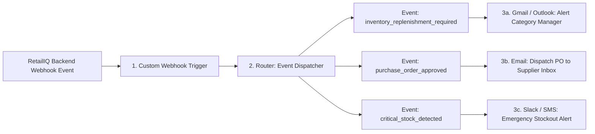

# RetailIQ – Make.com Automation Setup Guide

This guide explains how to connect RetailIQ to **Make.com** (formerly Integromat) to automate email notifications, supplier alert routing, and manager approval notifications.

---

## 1. Scenario Architecture Overview



---

## 2. Step-by-Step Scenario Configuration in Make.com

### Step 1: Create a New Scenario
1. Log in to [Make.com](https://www.make.com/).
2. Click **Create a new scenario**.
3. Name your scenario: `RetailIQ Inventory Automation & Alerts`.

### Step 2: Add Webhooks Trigger Module
1. Click the large `+` icon and search for **Webhooks**.
2. Select **Custom webhook**.
3. Click **Add** next to the Webhook field.
4. Set Webhook name: `RetailIQ Replenishment Webhook`.
5. Click **Save**.
6. Copy the generated URL (e.g., `https://hook.eu1.make.com/xxxxxxxxxxxxxxxxxxxxxxxx`).
7. Paste this URL into the **RetailIQ Web Dashboard** under **Make.com Automation** page, or set in `.env`:
   ```bash
   MAKECOM_WEBHOOK_URL=https://hook.eu1.make.com/your-custom-hook-id
   ```

### Step 3: Determine Data Structure (Test Payload)
1. On Make.com, while the module displays *"Listening for data"*, go to the **RetailIQ Dashboard** -> **Make.com Automation**.
2. Click **Send Test Webhook**.
3. Make.com will receive the test payload and display: `Successfully determined`.
4. Click **OK** in Make.com.

---

## 3. Supported Event Types & Schemas

### Event 1: `inventory_replenishment_required`
Dispatched whenever the RetailIQ AI Agent flags an SKU requiring procurement.

```json
{
  "source": "RetailIQ AI Inventory Intelligence",
  "event": "inventory_replenishment_required",
  "product_id": "SKU0001",
  "product_name": "Milk 1L",
  "category": "Dairy & Eggs",
  "current_stock": 9,
  "reorder_point": 10,
  "recommended_quantity": 24,
  "priority": "Critical",
  "supplier_id": "SUP012",
  "supplier_name": "Apex Retail Supply",
  "estimated_cost_inr": 4295.04,
  "currency": "INR",
  "timestamp": "2026-11-09T20:30:00"
}
```

### Event 2: `purchase_order_approved`
Dispatched when an inventory manager approves a purchase order draft.

```json
{
  "source": "RetailIQ AI Inventory Intelligence",
  "event": "purchase_order_approved",
  "po_id": "PO000251",
  "product_id": "SKU0001",
  "product_name": "Milk 1L",
  "order_quantity": 24,
  "total_order_value_inr": 4295.04,
  "supplier_id": "SUP012",
  "expected_delivery_date": "2026-11-10",
  "currency": "INR",
  "timestamp": "2026-11-09T20:35:00"
}
```

### Event 3: `critical_stock_detected`
Dispatched when physical stock on hand falls under 3 days of cover.

```json
{
  "source": "RetailIQ AI Inventory Intelligence",
  "event": "critical_stock_detected",
  "product_id": "SKU0002",
  "product_name": "Curd 500g",
  "category": "Dairy & Eggs",
  "current_stock": 6,
  "days_of_cover": 3.8,
  "safety_stock": 6,
  "currency": "INR",
  "timestamp": "2026-11-09T20:30:00"
}
```

---

## 4. Connecting Notification Modules (Gmail / Email)

### Route 1: Category Manager Alert
1. Add a **Router** module after the Webhook.
2. Filter Condition: `event` Equal to (case-sensitive) `inventory_replenishment_required`.
3. Add **Gmail: Send an email** module:
   - **To**: `manager.inventory@example.com`
   - **Subject**: `[RetailIQ Action Required] Replenish {{1.product_name}} (Priority: {{1.priority}})`
   - **Body (HTML)**:
     ```html
     <h3>RetailIQ Automated Replenishment Notification</h3>
     <p>The AI Inventory Agent has evaluated stock levels and recommends procurement:</p>
     <ul>
       <li><strong>SKU:</strong> {{1.product_id}}</li>
       <li><strong>Product:</strong> {{1.product_name}} ({{1.category}})</li>
       <li><strong>Current Stock:</strong> {{1.current_stock}} units</li>
       <li><strong>Reorder Point (ROP):</strong> {{1.reorder_point}} units</li>
       <li><strong>Recommended Order:</strong> {{1.recommended_quantity}} units</li>
       <li><strong>Preferred Vendor:</strong> {{1.supplier_name}}</li>
       <li><strong>Est. Budget Required:</strong> INR {{1.estimated_cost_inr}}</li>
     </ul>
     <p>Please log in to the RetailIQ Dashboard to approve the purchase order draft.</p>
     ```

### Route 2: PO Approval to Supplier
1. Connect second path on the Router.
2. Filter Condition: `event` Equal to `purchase_order_approved`.
3. Add email module routing to `orders.supplier@example.com`.

---

## 5. Error Handling & Standalone Graceful Fallback
- If Make.com is disconnected or the URL is omitted, RetailIQ continues to function in **100% standalone offline mode**.
- The backend checks for network connectivity and logs any timeouts without throwing application-breaking exceptions.
- The UI status indicator reflects `"Disconnected"`, `"Configured"`, or `"Connected"` based on the last live test.

